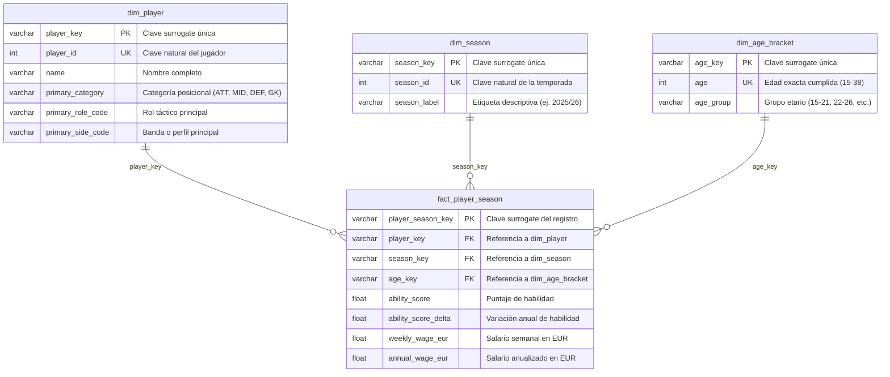

# Análisis del ciclo de vida futbolístico según la posición con base en el rendimiento, la longevidad y el impacto de estos en el ingreso salarial en el periodo 2022-2026

## Introducción

En el ámbito del fútbol profesional actual, el uso de la analítica de datos ha transformado tanto la administración deportiva como la económica, comprender el ciclo de vida de los futbolistas, su rendimiento pico, longevidad por posición y tasa de declive. Es fundamental para optimizar la toma de decisiones y la inversión en plantillas.

No obstante, a menudo hay una falta de conexión entre el desempeño en el campo y la compensación económica. Esta investigación analiza el ciclo de vida profesional de los futbolistas durante el periodo 2022–2026. A través del análisis de sus habilidades, longevidad posicional y salarios activos, este estudio evalúa si la valoración económica del mercado refleja el rendimiento real o responde a distorsiones históricas del fútbol profesional. 

## Planteamiento del problema

En el fútbol profesional, las decisiones estratégicas se basan cada vez más en métricas creadas para comprender cómo su desempeño los posiciona en el campo. En un mercado, donde los futbolistas son la inversión principal de las organizaciones para quienes es indispensable garantizar la eficiencia entre sus principales activos. La tendencia a generalizar el envejecimiento deportivo genera percepciones erróneas sobre la vida útil, el inicio del declive físico y el momento de máximo desempeño de los jugadores según su posición en el campo.

La falta de caracterización de estos análisis genera que la estructura salarial y negociaciones de traspaso no se ajusten a la habilidad real en la cancha, donde el contrato del deportista pase a estar fundamentada no solo en el rendimiento en el campo, sino además, depender en exceso a factores como su reputación mediática, su impacto comercial o como es percibido por la fama obtenida. Esto crea un desfase temporal entre el verdadero pico de habilidad deportiva del atleta y el momento en el que alcanza su tope salarial.

A nivel institucional, este fenómeno induce a una ineficiencia sistemática en la toma de decisiones. Asumir altos costos salariales por jugadores que ya han superado su pico de rendimiento en su posición específica compromete el presupuesto y la competitividad deportiva del equipo. Ante la necesidad de optimizar los recursos en el mercado actual, surge la siguiente interrogante: ¿Cómo varía el rendimiento, medido por el puntaje de habilidad, entre los grupos de edad según la posición de juego, y en qué medida coincide la edad de mayor rendimiento con la de mayor ingreso salarial en los futbolistas registrados en la base de datos del proyecto durante el periodo 2022-2026?

En base a lo anterior se plantean las siguientes preguntas de investigación:

1. ¿Cuál es el puntaje de habilidad promedio de cada grupo etario (15-21, 22-26, 27-31 y 32-38 años) y cómo varía a lo largo del periodo 2022-2026?
2. ¿Qué posición de juego presenta mayor longevidad, entendida como la mayor proporción de jugadores en el grupo de 32 a 38 años y la menor disminución del puntaje de habilidad con la edad?
3. ¿Cómo varía el salario anual promedio según el grupo etario y la posición de juego a lo largo del periodo 2022-2026?
4. ¿En qué grupo etario alcanza cada posición  su mayor puntaje de habilidad y su mayor salario anual, y coinciden ambos momentos?
5. ¿Qué grado de correlación existe entre el puntaje de habilidad y el salario anual dentro de cada grupo etario y posición de juego?

## Objetivo General

Analizar el ciclo de vida profesional de los futbolistas en las distintas posiciones a lo largo del periodo 2022-2026, mediante la evaluación del desarrollo profesional de los deportistas con el propósito de determinar las edades de mayor rendimiento y la relación con su ingreso salarial.

## Objetivos Específicos

- Promediar el rendimiento anual a través del puntaje de habilidad entre los años 2022, 2023, 2024, 2025 y 2026 en las categorías etarias de  15-21, 22-26, 27-31, 32-38 para lograr una mayor comprensión del rendimiento entre los años de estudio y comparación entre los mismos.
  
- Comparar las trayectorias de envejecimiento entre las posiciones en el campo para identificar qué roles tienen la mayor longevidad.

- Estudiar el crecimiento salarial de los futbolistas en el periodo 2022-2026 calculando el salario promedio basado en sus contratos, clasificándolos en grupos etarios de 15-21, 22-26, 27-31, 32-38 y su posición.

- Comparar la relación entre el mayor puntaje de habilidad con la edad que alcanza su pico salarial, para identificar si existe una convergencia entre el mejor momento deportivo y su ingreso máximo según la posición.

- Calcular el coeficiente de correlacion del puntaje de habilidad con el ingreso salarial dentro de cada categoría y posición para medir el impacto financiero del rendimiento deportivo.

## Justificación

Esta investigación es fundamental para entender cómo ha cambiado la gestión deportiva tanto operativa como financieramente frente a la creciente profesionalización de la analítica de datos en el deporte. Desde el punto de vista del mercado, establecer o no la existencia de un desfase temporal entre el máximo nivel de habilidad atlética y el salario más alto permitirá a directivos, representantes y marcas deportivas ajustar sus tácticas de contratación, renovación y gestión de activos de acuerdo a los verdaderos ciclos de vida de los deportistas. Desde un enfoque estadístico, el análisis se respalda al incluir un estudio a lo largo del periodo 2022-2026 que desafía la percepción común: mostrar si el valor monetario de un atleta está vinculado de manera lineal a su rendimiento actual o si está influenciado por reputaciones y contratos del pasado. Adicionalmente, al analizar estos datos según la posición y grupos de edad, el estudio aportará valor al identificar si las demandas táctico-físicas influyen en la durabilidad en el deporte o si existen distorsiones salariales a lo largo de toda la estructura del fútbol profesional.

## Herramientas Tecnológicas Utilizadas

- Python, SQLite, DuckDB, Snowflake, DBT Core, Power BI, Streamlit.

## Bosquejo del Modelo de Datos Desnormalizado 

Para facilitar el procesamiento analítico, la evaluación del rendimiento por posición y el estudio de la longevidad deportiva y su impacto en el ingreso salarial durante el periodo 2022-2026, los datos se estructuran bajo un modelo dimensional en esquema de estrella.

Este esquema centraliza las métricas deportivas, las variaciones interanuales de nivel y los ingresos salariales en una tabla de hechos periódica (`fact_player_season`), conectada directamente a tres dimensiones conformadas: datos del jugador y su rol táctico (`dim_player`), temporalidad del estudio (`dim_season`) y segmentación etaria (`dim_age_bracket`). Esta estructura optimizada permite responder de forma directa a los objetivos de investigación del ciclo de vida futbolístico, garantizando consultas analíticas de alto rendimiento sin combinaciones complejas en tiempo de ejecución.

## Diagrama de Entidad-Relación (DER)

## Cardinalidad y Relaciones entre Entidades

Las relaciones del diagrama configuran un esquema en estrella con patrones estrictos de Uno a Muchos (1:N) entre las dimensiones conformadas y la tabla de hechos central:

* **dim_player → fact_player_season (1:N)**: Un jugador único registrado en la dimensión puede tener múltiples registros en la tabla de hechos, uno por cada temporada en la que participó entre 2022 y 2026. Cada registro de hecho corresponde exclusivamente a un único jugador identificado mediante `player_key`.

* **dim_season → fact_player_season (1:N)**: Una temporada deportiva de estudio (`2022/23`, `2023/24`, `2024/25`, `2025/26`) agrupa los hechos y rendimientos de miles de futbolistas activos durante dicho periodo. Sin embargo, cada fila de la tabla de hechos pertenece a una única temporada vinculada por `season_key`.

* **dim_age_bracket → fact_player_season (1:N)**: Una edad exacta o grupo etario de estudio se asocia a múltiples observaciones anuales de jugadores que tenían esa edad en una temporada dada. Cada hecho anual del jugador se mapea a una única edad y rango etario mediante `age_key`.

## Colaboradores del Proyecto 

| Integrante | Rol en el Proyecto | Contribuciones Principales |
| :--- | :--- | :--- |
| **Jorge Torres** | Tech Lead & Data Engineer | Arquitectura de datos, pipelines (SQL/Snowflake), modelado en dbt, gestión de PRs y roles.
| **Noryen Haringhton** | SME & Data App Developer | Lógica de negocio (Fútbol), desarrollo de componentes y diseño de frontend en Streamlit.
| **Angel Pastrano** | BI Developer | Desarrollo integral del dashboard en Power BI, creación de métricas y visualizaciones.
| **Johan Infante** | Data Analyst | Desarrollo de queries SQL para objetivos de negocio y configuración de Streamlit.|
| **Gabriel Ugas** | BI Analyst & Tech Writer | Ejecución de tareas en Power BI y desarrollo de la documentación del repositorio.
| **Stephannie Labrador** | Technical Writer & UI/UX Lead | Documentación teórica del proyecto y aportes en el diseño de la aplicación.

## Estructura del Repositorio

- [📁 **app/**](https://github.com/Jtorres1000/Football_players_analysis/tree/main/app): Contiene la aplicación web interactiva desarrollada con *Streamlit*. Incluye las vistas de navegación ([`pages/`](https://github.com/Jtorres1000/Football_players_analysis/tree/main/app/pages)), componentes visuales ([`components/`](https://github.com/Jtorres1000/Football_players_analysis/tree/main/app/components)), estilos y el punto de entrada principal ([`app.py`](https://github.com/Jtorres1000/Football_players_analysis/blob/main/app/app.py)) para explorar y visualizar los datos analizados.
- [📁 **assets/**](https://github.com/Jtorres1000/Football_players_analysis/tree/main/assets): Almacena recursos gráficos y diagramas explicativos del proyecto, tales como el Diagrama Entidad-Relación ([`DER.png`](https://github.com/Jtorres1000/Football_players_analysis/blob/main/assets/DER.png)) y el esquema de denormalización de datos ([`DENORMALIZACION.png`](https://github.com/Jtorres1000/Football_players_analysis/blob/main/assets/DENORMALIZACION.png)).
- [📁 **football_analytics_dbt/**](https://github.com/Jtorres1000/Football_players_analysis/tree/main/football_analytics_dbt): Proyecto de ingeniería de analítica con *dbt Core*. Contiene los modelos SQL modulares organizados en capas (*staging* y *marts*), macros, tests de calidad de datos y configuraciones para transformar datos dentro del Data Warehouse.
- [📁 **power_bi/**](https://github.com/Jtorres1000/Football_players_analysis/tree/main/power_bi): Espacio reservado para los tableros de control, plantillas y reportes interactivos de *Power BI* enfocados en la inteligencia de negocios y presentación ejecutiva de las métricas.
- [📁 **scripts/**](https://github.com/Jtorres1000/Football_players_analysis/tree/main/scripts): Scripts utilitarios en Python para tareas de automatización, ingesta y transformación de datos, como la conversión de tablas SQLite a archivos Parquet de alto rendimiento mediante *DuckDB* ([`raw_parquets.py`](https://github.com/Jtorres1000/Football_players_analysis/blob/main/scripts/raw_parquets.py)).
