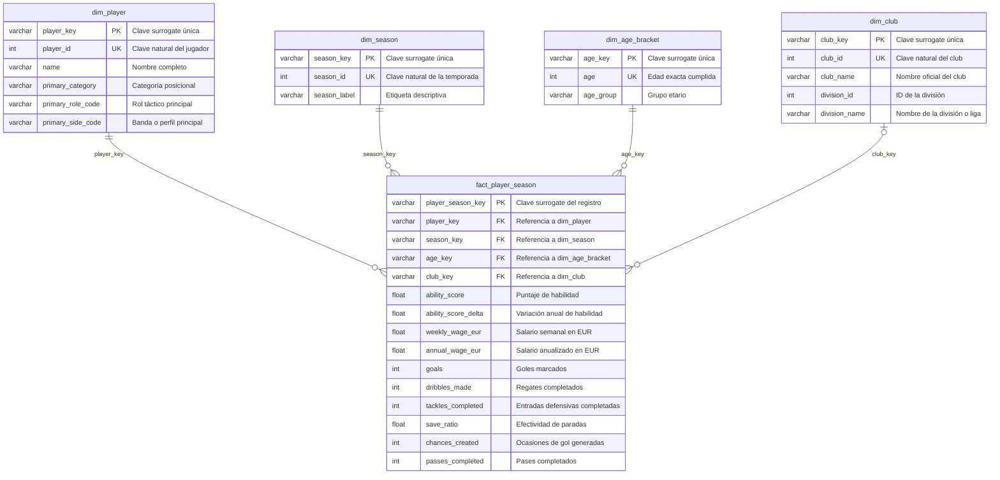

# Football Analytics dbt

[](https://docs.getdbt.com/)
[](https://www.snowflake.com/)
[](https://docs.snowflake.com/)

Proyecto de ingeniería analítica desarrollado con dbt Core y snowflake para transformar los datos crudos de rendimiento, contratos, clubes y temporadas del periodo 2022–2026 en un modelo dimensional en esquema de estrella, diseñado para el análisis del ciclo de vida futbolístico, la longevidad posicional, el impacto salarial y el scouting en Streamlit y Power BI.

---

## Tabla de contenidos

1. [Arquitectura del proyecto y capas de modelado](#arquitectura-del-proyecto-y-capas-de-modelado)
2. [Catálogo de modelos](#catálogo-de-modelos)
   - [Fuentes de datos](#1-fuentes-de-datos)
   - [Capa de staging](#2-capa-de-staging)
   - [Capa de marts](#3-capa-de-marts)
3. [Esquema dimensional](#esquema-dimensional)
4. [Calidad de datos y pruebas](#calidad-de-datos-y-pruebas)
5. [Configuración y ejecución](#configuración-y-ejecución)

---

## Arquitectura del proyecto y capas de modelado

El proyecto estructura el flujo de transformación en tres niveles dentro de la base de datos `TF_COMPU_II` en Snowflake:

| Capa | Ubicación | Materialización | Propósito principal |
| :--- | :--- | :---: | :--- |
| **Sources** | `models/football_data/staging/sources.yml` | Tablas crudas | Ingesta de las tablas de origen alojadas en el esquema `FOOTBALL_ANALYSIS`. |
| **Staging** | `models/football_data/staging/` | `view` | Limpieza, conversión de tipos de datos, reemplazo de valores nulos y estandarización de columnas con relación uno a uno respecto a las tablas de origen. |
| **Marts** | `models/football_data/marts/` | `table` | Modelo dimensional en esquema de estrella con claves subrogadas generado para el consumo directo en herramientas analíticas. |

---

## Catálogo de modelos

### 1. Fuentes de datos

Se define a football_data como la fuente de datos crudos y en snowflake se conecta con la base de datos TF_COMPU_II y el esquema FOOTBALL_ANALYSIS, desde donde se leen las tablas que alimentan el flujo de transformación.

### 2. Capa de staging

Modelos con participación directa en la construcción del modelo dimensional:

| Modelo | Tabla origen | Transformaciones principales |
| :--- | :--- | :--- |
| `stg_football_data__PLAYERS_RAW` | `PLAYERS_RAW` | Conversión de tipos para identificadores, datos biométricos, nacionalidad y categoría posicional general. |
| `stg_football_data__POSITIONS_RAW` | `POSITIONS_RAW` | Tipado de los códigos de rol táctico y banda de juego. |
| `stg_football_data__PLAYER_POSITIONS_RAW` | `PLAYER_POSITIONS_RAW` | Asociación entre jugadores, posiciones y orden de prioridad táctica. |
| `stg_football_data__SEASONS_RAW` | `SEASONS_RAW` | Tipado del identificador de temporada, etiqueta del periodo y orden cronológico. |
| `stg_football_data__CLUBS_RAW` | `CLUBS_RAW` | Estandarización del identificador de club, nombre oficial y clave de división. |
| `stg_football_data__DIVISIONS_RAW` | `DIVISIONS_RAW` | Tipado del catálogo de ligas y su coeficiente de nivel competitivo. |
| `stg_football_data__CONTRACTS_RAW` | `CONTRACTS_RAW` | Conversión de fechas de inicio y fin de contrato, salario semanal y valor contractual en euros. |
| `stg_football_data__PLAYER_SEASONS_RAW` | `PLAYER_SEASONS_RAW` | Tipado de edad, minutos, titularidades, cálculo del total de apariciones y puntaje de habilidad por temporada. |
| `stg_football_data__PLAYER_STATS_ATTACKING_RAW` | `PLAYER_STATS_ATTACKING_RAW` | Normalización de métricas ofensivas reemplazando valores nulos por cero en goles, regates, ocasiones creadas y goles esperados. |
| `stg_football_data__PLAYER_STATS_DEFENDING_RAW` | `PLAYER_STATS_DEFENDING_RAW` | Normalización de métricas defensivas como entradas completadas, intercepciones, despejes, bloqueos y presiones. |
| `stg_football_data__PLAYER_STATS_GOALKEEPING_RAW` | `PLAYER_STATS_GOALKEEPING_RAW` | Normalización de indicadores de portería incluyendo proporción de paradas, vallas invictas y goles evitados. |
| `stg_football_data__PLAYER_STATS_PASSING_RAW` | `PLAYER_STATS_PASSING_RAW` | Normalización de métricas de distribución tales como pases completados, pases progresivos, pases clave y centros. |

### 3. Capa de marts

| Modelo | Tipo | Clave primaria 
| :--- | :---: | :---: |
| **`dim_player`** | Dimensión | `player_key` | 
| **`dim_season`** | Dimensión | `season_key` | 
| **`dim_age_bracket`** | Dimensión | `age_key` | 
| **`dim_club`** | Dimensión | `club_key` | 
| **`fact_player_season`** | Hechos | `player_season_key` |

---

## Esquema dimensional


---

## Calidad de datos y pruebas

Las pruebas declarativas se encuentran configuradas en los archivos `schema.yml` de ambas capas:

* **Unicidad y no nulidad**: Validaciones de tipo único y not null sobre todas las claves primarias subrogadas, claves naturales de las dimensiones y métricas principales de la tabla de hechos.
* **Integridad referencial**: Pruebas relationships en fact_player_season hacia las dimensiones: dim_player, dim_season, dim_age_bracket y dim_club, así como entre los modelos de la capa de staging.
* **Valores aceptados**: Reglas para valores aceptados para restringir los campos de de primary_category a GOALKEEPER, DEFENDER, MIDFIELDER y ATTACKER, y validar que los rangos de age_group sean 15-21, 22-26, 27-31 y 32-38.

---

## Configuración y ejecución

### Requisitos previos
* Python 3.10 o superior.
* Paquetes `dbt-core` y `dbt-snowflake` instalados en el entorno virtual.
* Archivo `~/.dbt/profiles.yml` configurado con el perfil `football_analytics_dbt` apuntando al warehouse de Snowflake.

### Comandos de ejecución

Desde el directorio `football_analytics_dbt/`:

```bash
# Verificar la configuración y conexión con Snowflake
dbt debug

# Instalar paquetes definidos en packages.yml
dbt deps

# Materializar las vistas de staging y las tablas de marts
dbt run

# Ejecutar las pruebas de integridad y calidad de datos
dbt test

# Ejecutar modelos y pruebas de forma integrada siguiendo el linaje de los modelos
dbt build
```

### Generación de documentación interactiva

```bash
dbt docs generate
dbt docs serve
```
